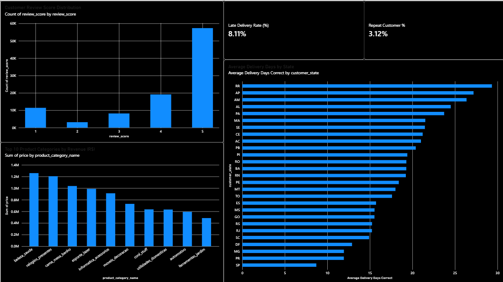
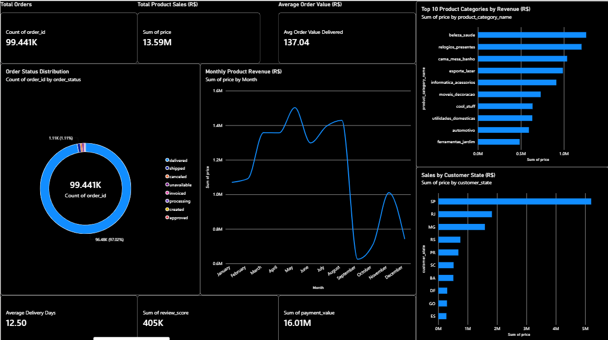

# RetailPulse — End-to-End E-Commerce Analytics & Data Engineering Platform

RetailPulse is an end-to-end data analytics and engineering project built using the Brazilian E-Commerce Public Dataset by Olist. It transforms raw e-commerce data into structured PostgreSQL tables, performs business-focused SQL analysis, and presents key performance indicators through interactive Power BI dashboards.

The project demonstrates practical skills in **Python ETL, data cleaning, PostgreSQL, SQL analytics, and business intelligence**.

## Project Overview

- **Data Source:** Olist Brazilian E-Commerce Dataset
- **ETL:** Python and Pandas
- **Database:** PostgreSQL
- **Analytics:** SQL
- **Visualization:** Power BI Desktop
- **Tools:** VS Code, pgAdmin, Git, GitHub

## Architecture

```text
Olist CSV Dataset
       |
       v
Python ETL Pipeline
  Extract → Transform → Load
       |
       v
PostgreSQL Reporting Tables
       |
       v
SQL Business Analysis
       |
       v
Power BI Dashboards
```

## Power BI Dashboards

### 1. Executive Overview

Provides a high-level view of e-commerce performance, including order volume, product sales, average order value, order status distribution, monthly product revenue, and sales by customer state.



### 2. Product & Delivery Insights

Explores customer review scores, top product categories by revenue, delivery performance across customer states, late delivery rate, and repeat customer rate.



## ETL Pipeline

The Python ETL pipeline is organized into reusable scripts:

- **Extract:** Reads the source CSV files using Pandas.
- **Transform:** Cleans data, handles duplicates, standardizes values, converts data types, and prepares processed datasets.
- **Load:** Loads the processed data into dedicated PostgreSQL reporting tables.
- **Pipeline Orchestration:** Runs the extraction, transformation, and loading steps through a single pipeline script.

### Reporting Tables

The pipeline creates reporting tables for:

- Orders
- Order items
- Customers
- Products
- Payments
- Reviews

## SQL Business Analysis

The SQL analysis covers business questions such as:

- Overall order volume and order status distribution
- Monthly product revenue trends
- Top product categories by revenue
- Payment methods and payment values
- Average order value for delivered orders
- Revenue by customer state
- Average delivery duration and late deliveries
- Customer review score distribution
- Month-over-month revenue comparisons
- Product category rankings
- Repeat customer analysis
- Delivery performance by state

The analysis uses SQL aggregations, joins, common table expressions, window functions, and conditional calculations.

## Key Dashboard Metrics

The dashboards include:

- Total orders
- Total product sales
- Average order value
- Monthly product revenue
- Customer review score distribution
- Top 10 product categories by revenue
- Sales by customer state
- Average delivery days by state
- Late delivery rate
- Repeat customer rate

*Note: Product revenue is calculated from order-item prices. It is distinct from total payment value, which may include freight and other payment components.*

## Project Structure

```text
RetailPulse/
├── data/
│   ├── raw/                 # Original dataset files (not committed)
│   └── processed/           # Processed CSV files (not committed)
├── src/
│   ├── extract.py
│   ├── transform.py
│   ├── load.py
│   └── run_pipeline.py
├── sql/
│   ├── 01_setup.sql
│   └── 02_analysis_queries.sql
├── docs/                    # Project documentation
├── screenshots/
│   ├── dashboard_overview.png.png
│   └── product_delivery_insights.png.png
├── inspect_data.py
├── requirements.txt
├── .gitignore
└── README.md
```

## Run the Project Locally

### Prerequisites

- Python
- PostgreSQL and pgAdmin
- Power BI Desktop
- Git

### 1. Clone the repository

```bash
git clone https://github.com/Vaishnavi646606/RetailPulse-End-to-end-E-commerce-Analytics-and-Data-Engineering-Project.git
cd RetailPulse-End-to-end-E-commerce-Analytics-and-Data-Engineering-Project
```

### 2. Set up Python

```powershell
python -m venv .venv
.\.venv\Scripts\Activate.ps1
python -m pip install --upgrade pip
pip install -r requirements.txt
```

### 3. Prepare the dataset

Download the [Olist Brazilian E-Commerce Dataset](https://www.kaggle.com/datasets/olistbr/brazilian-ecommerce) and place the required CSV files in `data/raw/`.

### 4. Configure PostgreSQL

Create a PostgreSQL database named `retailpulse`.

Create a `.env` file in the project root with your local database credentials:

```text
DB_HOST=localhost
DB_PORT=5432
DB_NAME=retailpulse
DB_USER=postgres
DB_PASSWORD=your_local_password
```

Replace `your_local_password` with your own PostgreSQL password. Never commit the `.env` file.

### 5. Run the ETL pipeline

```bash
python src/run_pipeline.py
```

The pipeline processes the source data and loads the reporting tables into PostgreSQL.

### 6. Explore SQL analysis

Open `sql/02_analysis_queries.sql` in your SQL editor and execute the queries against the `retailpulse` database.

### 7. Explore the Power BI report

Open Power BI Desktop and connect to the PostgreSQL reporting tables. The committed screenshots provide a preview of the completed report pages.

## Data Quality and Design Considerations

- Raw data and processed CSV files are excluded from Git.
- Database credentials are stored locally in `.env`.
- Reporting tables are separated from the original source tables.
- Revenue metrics use order-item prices to avoid confusing product sales with total payment value.
- Joins and aggregations should be validated to prevent double-counting.

## Skills Demonstrated

`Python` · `Pandas` · `ETL Pipelines` · `PostgreSQL` · `SQL` · `Power BI` · `Data Cleaning` · `Data Modeling` · `Business Intelligence` · `Git` · `GitHub`

## Author

**Vaishnavi Shewale**

[GitHub Repository](https://github.com/Vaishnavi646606/RetailPulse-End-to-end-E-commerce-Analytics-and-Data-Engineering-Project)
